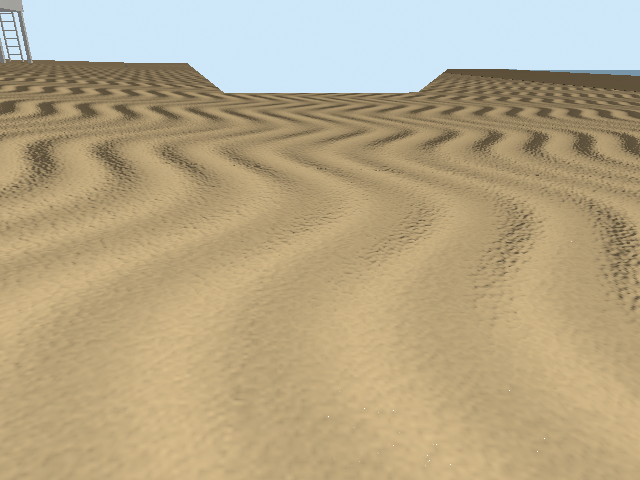
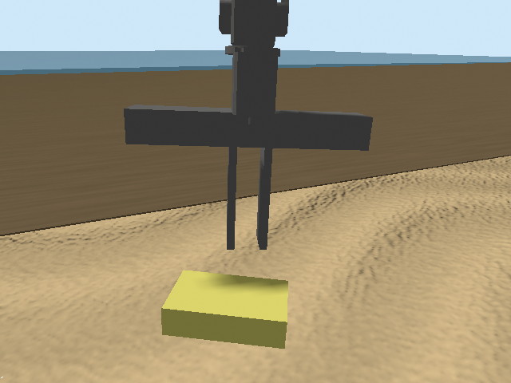
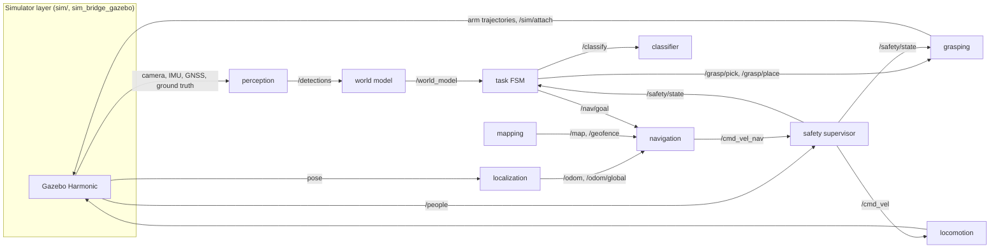

# Beach Cleanup Robot Dog

**A simulated Unitree Go2 quadruped with an arm that is meant to search a beach, pick up litter, sort it by material and empty it into the right bin, with no human in the loop. Every part runs in ROS 2 and Gazebo Harmonic on a laptop CPU.**

> 🚧 **Work in progress (as of 2026-11-05).** The whole loop runs on its own, unattended. Every component still reads the simulator's ground truth (perception, localization, classification), and grasps use a simulated attach; the real implementations are the upgrades now under way. On the 10-scene benchmark, the best configuration so far (`b3_nav`) collected 39 of 110 items, all of them in the correct bin, finished three scenes completely and no longer gets stuck in navigation; the other 7 runs still end in a fall of the walking controller. The row before it (`b2_bins`) had the project's first safety violation (see [Results](#results)). The [progress table](#progress) shows what is built and what is still planned.

<p align="center">
  
  &nbsp;
  
  <br>
  <sub>Views from the robot's head camera in Gazebo: a generated beach scene (left) and the custom wide gripper above a cigarette pack (right).</sub>
</p>

<!-- TODO (packaging phase): 60–90 s hero video of a full cleanup run plus 2–3 honest failure clips -->

## The goal

The robot carries a two-compartment basket on its back and runs this loop:

1. **Search.** Walk a lawnmower pattern inside the beach's geofence and look for litter among shells, rocks, seaweed and driftwood.
2. **Pick.** Walk up to an item, stand still and grasp it from above.
3. **Classify.** Hold the item in front of the head camera and decide what material it is: PET, metal, glass or residual.
4. **Store.** Drop it into the matching compartment, **recyclable** or **residual**.
5. **Unload.** When the basket is full or the area is done, walk to the two bins and empty each compartment into its bin.

A rule-based safety supervisor runs throughout. It slows the robot when a person comes within 3 m and stops it early enough that it is at rest before the person is within 1.5 m (the stop distance grows with the robot's speed, as in speed and separation monitoring), keeps it inside the geofence, and freezes the arm unless nobody is nearby.

## Why this project

In Hong Kong I took part in a lot of beach clean-ups. Most of the litter we picked up wasn't left by people on the beach: it washed in from the sea. Hong Kong's own Marine Refuse Study links the refuse on its shores to the seasonal winds and the Pearl River outflow ([LegCo reply, 2016](https://www.info.gov.hk/gia/general/201612/14/P2016121400394p.htm)), and a survey of one west-coast beach found that local sources made up only a small share of the stranded debris ([EdUHK](https://repository.eduhk.hk/en/publications/the-origin-of-stranded-shoreline-macroplastic-debris-in-hong-kong/)). And none of what we collected was recycled: bottles and cans went into general waste with everything else. Picking litter up by hand only to throw it all away seemed like a waste, and not how it should be done today.

So this robot does both jobs: it collects the litter and sorts it on the spot. That is also why the benchmark weights its mistakes: a residual item in the recycling bin spoils the recycling, so it counts double.

## Progress

| Phase | What | Status |
|---|---|---|
| **A0** Setup | Go2 walks on `/cmd_vel` in Gazebo; WidowX 250 arm and two-compartment basket mounted | ✅ done |
| **A1** Beach world | Seeded scene generator, dune terrain with dry and wet sand, trash, distractors, bins, a walking person, sensors bridged to ROS 2 | ✅ done |
| **A2a** Components | Every pipeline component built as a ground-truth baseline, with unit and node tests | ✅ done |
| **A2b** Integration | The whole pipeline running together in Gazebo, end to end and unattended | ✅ done: a full unattended run works on the small dev scene; on benchmark-size scenes the walking controller still falls (a known limitation the benchmark measures) |
| **A3** Benchmark | `make bench` over 10 seeded scenes, unattended overnight; baseline results row | ✅ done: baseline row with zero safety violations; most runs end in a fall or a navigation stall (see Results) |
| **B1–B4** Real upgrades | Make the robot itself better while every input is still ground truth, one at a time, each benchmarked against the row before: (1) bin rim height, (2) placing in both bins without walking between them, (3) navigation stalls, (4) a walking controller that falls less | 🟡 B1–B3 done (rows `b1_rim`, `b2_bins`, `b3_nav`); next: B4 |
| **C1–C5** Ground truth → real | Replace each ground-truth baseline with a real component: (1) EKF localization (GNSS + leg odometry + IMU), (2) realistic trash visuals, (3) detection with a pretrained text-prompted model, (4) material classifier, (5) an industry-style perception + grasping pipeline (look → plan → move → verify) with picks done by contact physics. The ground-truth rows are the upper bound, so each row shows what making that component real costs | 🟡 C1–C3 in progress |
| **D0–D1** Isaac Sim | Port to NVIDIA Isaac Sim with no changes outside the simulator layer; Gazebo-vs-Isaac comparison | ⬜ optional |

### Implemented vs. planned, per component

In this project a *baseline* reads the simulator's ground truth. Each baseline is built first so the whole pipeline can be tested end to end. Each one is then replaced by a real implementation behind a launch argument, and the baseline is kept for comparison.

| Component | Implemented now | Planned upgrade |
|---|---|---|
| Locomotion | [legubiao/quadruped_ros2_control](https://github.com/legubiao/quadruped_ros2_control) controller (pinned, two small patches); fall detection makes the legs go passive | Tested: the pretrained HIMLoco policy (ICLR 2024) from the same repo, on the CPU (`locomotion:=legubiao_rl`): no falls in our tests, but it doesn't move at the slow speeds the approach needs (it was trained without commands below 0.2 m/s), so it isn't the default. Next (B4): a controller that falls less, picked by a repeatable fall test (candidates: the `robot_lab` policy, tuned gains of the current controller, the OCS2 MPC controller from the same repo). Later: own Isaac Lab RL policy (Part D) |
| Robot | Go2 + Interbotix WidowX 250 6DOF + custom wide jaws (2–15 cm) + 34 × 30 cm basket, own xacro | — |
| World | 10 seeded scenes (25 × 20 m, 8–15 trash items, 6–12 distractors, a walking person in 5 of them), procedural meshes | Better-looking trash meshes before training the detector |
| Localization | Ground-truth pose published as `/odom`, `/odom/global` and TFs | Dual EKF + `navsat_transform` over noisy GNSS, leg odometry and IMU |
| Mapping | Static traversability grid from the terrain (steep slopes and water are blocked) | — |
| Perception | Ground-truth detections from the simulator | A pretrained open-vocabulary model prompted with text (YOLOE), with no training, plus depth for 3D position. Compared with a classical segmentation of our own. |
| Classifier | Ground-truth material + sorting rules from config | Zero-shot classifier on close-up crops; confusion matrix and contamination rate |
| World model | Removes duplicate detections, tracks the coverage grid and what is in each compartment | — |
| Navigation | Nav2 (NavFn planner + Regulated Pure Pursuit) plus a camera-relative final approach | — |
| Grasping | Own IK and reach-envelope module, scripted top-down pick, "attach on contact" in simulation | **Last and hardest step (C5).** Picks by contact physics (a feasibility study is done, see below). Stages: segment the item, estimate its geometry, generate grasp candidates (`simple_grasping` and our own), plan the motion (MoveIt 2 / MTC and our own planner), then a guarded descent and a check that the grasp worked. |
| Safety | Rule-based supervisor, the only publisher of `/cmd_vel`: person slow/stop, e-stop, geofence, arm interlock | — |
| Task | State machine with retries, skips, pause on a safety state and fall handling; one event log per run | — |
| Benchmark | `make bench`: 10 seeded scenes headless, one JSON per run, metrics from the final ground truth, one row per configuration in `results/results.md` | A row per upgrade |

## Design choices

- **Safety is its own layer.** Navigation publishes `/cmd_vel_nav`. Only the supervisor publishes `/cmd_vel`, and it has no shortcut, not even for teleop or debugging. The arm does not go through the supervisor, so the grasping node holds the arm still unless `/safety/state == ok`. Any motion planner added later may only plan, and its trajectories still run through that gate.
- **The interfaces are frozen and the simulator is a component.** Components talk only through a fixed set of ROS 2 topics, services and actions. All Gazebo-specific code lives in `sim/` and `sim_bridge_gazebo`, so porting to Isaac Sim means writing one new bridge package.
- **Mistakes are weighted by their consequence.** The classifier says *what* an item is, and `config/sorting_rules.yaml` says *where* it goes. A residual item in the recycling bin is worse than the reverse, so an item classified with low confidence goes to residual.
- **The map gets the robot near, the camera finishes the job.** Navigation works in the map frame to about half a metre. Grasping and placing work relative to the camera, to the centimetre.
- **No SLAM.** An open beach has too few features for it. Localization will fuse plain GPS (2–3 m noise), leg odometry and IMU.
- **Thresholds live in config.** Safety distances, the geofence, sorting rules and grasp settings are all in `config/`, not in code.

The main trade-offs, with the evidence and the alternatives that were rejected: [docs/design-decisions.md](docs/design-decisions.md).

## Engineering so far

Some results from building this, beyond the code itself:

- **Physics-grasp feasibility study.** Can the custom gripper hold each trash item by friction alone, through a lift, a wrist turn and 1 m of walking? Every item stayed in the jaws in at least 6 of 10 valid trials. Cans, the glass jar and the cup succeeded 10 of 10 times; the food container (6/10) and the cigarette pack (7/9) are the weak cases. The study led to resizing two items and dropping the 1.5 L bottle from the item set. Data and method: [results/physics_grasp/](results/physics_grasp/).
- **Cross-phase tests.** Unit tests check that the parts fit together physically: the gripper fits every item, the arm reaches every compartment position and both bins, and the arm's sweep clears the bin wall. They were added after a run where the folded arm hit a bin and levered the robot over.
- **Debugging in a slow simulation.** The simulation runs at about 0.4× real time on the laptop CPU. A full scene takes about 15 simulated minutes, or 40 wall-clock minutes. Problems found in Gazebo runs and fixed include:
  - wall-clock timeouts that fired too early at that speed;
  - "phantom" items from a gripper TF that lagged behind the camera;
  - falls caused by walking with the arm raised;
  - the robot being unable to back away from a bin under Nav2.

  Each fix is backed by a regression test.
- **339 unit and node tests** (`make test`) run against a fake simulator, without Gazebo.

### Integration runs (Gazebo)

Taken from the task's event logs. These runs were for debugging and are not benchmark results.

- `a2b_dev1` (dev scene 101, 15 × 12 m): **first complete unattended run.** All 6 items were picked, sorted and ended up in the correct bins, with no fall. One glass bottle came out of the basket together with the item stored on top of it and landed in the right bin; the task now counts such an item as placed.
- Scene 3 (25 × 20 m), four runs: each fell, for a different reason each time:
  1. a held item swept into the basket wall during storing and the rigid simulated grasp pushed the robot;
  2. it stepped on a 2 cm seaweed clump;
  3. Nav2's turn on the spot at a goal reversed direction;
  4. it tipped over while standing still at a bin, with no command at all.
  
  The first three were fixed: a new arm path, every distractor marked as a map obstacle, and smoothed commands. The fourth run got furthest: 8 items picked and stored and all 4 recyclable items placed, before the fall. The basket was also reworked: items go to the lowest free spot, and items that fall out are looked for again.

**Open problem:** falls on benchmark-size scenes. The walking controller is blind and doesn't correct its balance from what it senses. Weight is not the cause: it walked as steadily with 6 kg as without in A0.

### Learned walking policy tested (HIMLoco)

The pretrained HIMLoco policy (Long et al., ICLR 2024) ships with the same controller repo and runs on the CPU through libtorch. It is wired in as a second implementation (`locomotion:=legubiao_rl`, `make run LOCO=legubiao_rl`) and was compared with the current controller on the same tests:

| Test | HIMLoco | Current controller |
|---|---|---|
| Fill the basket, then walk 2 m out and back with 180° turns (4 walks) | no fall; 19 of 20 items stayed in the basket | 2 falls in 4 walks; 10 of 10 items stayed in the run without a fall |
| Stand 5 min at the spot of the stand-still fall | no fall (max tilt 7°) | no fall (max tilt 1°) |
| Slow commands: 0.05–0.10 m/s forward, slow right turns | **doesn't move** | follows them |
| Full scene-3 run | no item picked: both approaches stalled at the slow final steps | (see the four runs above) |

It never fell, but it can't walk slowly, and the approach to an item and the docking at a bin need slow steps. The cause is in its training code, which sets every command below 0.2 m/s to zero, so the policy never learned that range. It also stands 9 cm lower and about 6° tilted with the arm and basket, which it never saw in training. So the current controller stays the default, and an own policy trained with slow commands and the arm's mass is planned for Part D. One integration detail: upstream's config lists the leg joints in a different order from the policy's (front right first instead of front left), and with that order the robot fell as soon as the policy took over.

## Results

<!-- Filled only from results/results.md, never by hand. -->

Baseline row (2026-11-04, commit `318758e`): 10 seeded scenes, one run each, every component reading ground truth, grasps by simulated attach. Full row, column definitions and per-seed numbers: [`results/results.md`](results/results.md).

| Configuration | Items collected | Sorting accuracy | Contamination | False pickups | Grasp success | Falls / stuck | Safety violations | Min. distance to person | Localization drift |
|---|---|---|---|---|---|---|---|---|---|
| Baseline (ground truth) | 17/110 | 1.00 (17/17) | 0 | 0 | 0.92 (69/75), simulated attach | 7 / 3 of 10 runs | 0 | 0.22 m (robot at rest) | 0.002 m (ground truth) |
| B1: bin rim height from the terrain | 12/110 | 1.00 (12/12) | 0 | 0 | 1.00 (50/50), simulated attach | 10 / 0 of 10 runs | 0 | 0.09 m (robot at rest) | 0.003 m (ground truth) |
| B2: sideways step between the bins | 39/110 | 1.00 (39/39) | 0 | 0 | 0.93 (85/91), simulated attach | 5 / 3 of 10 runs | 1 | 0.04 m (robot at rest) | 0.002 m (ground truth) |
| B3: room to turn before navigating | 39/110 | 1.00 (39/39) | 0 | 0 | 0.93 (81/87), simulated attach | 7 / 0 of 10 runs | 0 | 0.04 m (robot at rest) | 0.003 m (ground truth) |

In the baseline, every item that reached a bin was in the right one, and no run had a safety violation. Few items reach a bin, though: 7 of the 10 runs ended with the walking controller falling (three of them on the short walk between the two bins) and 3 with the robot stuck in navigation. These two failures are where the upgrades start (B1–B3). Each later upgrade adds one row, including any that make things worse.

B1 (commit `f63ed1a`) puts each bin's rim at its real height: the bins stand on sand 5–23 cm above the level the task assumed, so the arm released items lower than intended. With the right rim, 12 items reached a bin: 10 placed and 2 correctly recognised as already inside (carried along with another item). One item could no longer be placed (out of the arm's reach at the correct height); B2 adds a lower release for that case. The row also shows how noisy the walking controller is: all 10 runs ended in a fall, 4 of them in the first 160 s and 7 of them away from the bins, before or without any placement. B1 can't change those runs, so this row's totals are lower than the baseline's from the falls alone.

B2 (commit `c5dfba7`) replaces the walk from one bin to the other (back out, turn, walk) with one straight sideways step of 1.2 m, and lets the arm release an item a little lower when the full height is out of reach. 39 items reached a bin, two runs finished the whole beach for the first time, all 5 sideways steps went through, and no run fell at the bins. Three runs still ended stuck in navigation (that's B3). This row has the project's first safety violation: in one run the robot was still creeping at 5–6 cm/s for about a second after the supervisor had stopped it, while the person walked up to 1.1 m. The supervisor's stop distance assumes the robot brakes faster than it did here; the longer runs meet the person far more often.

B3 (commit `205c7a5`) removes the navigation stalls. Nav2's path follower refuses to move while the robot's outline touches an obstacle cell, including while it turns on the spot towards its path, and the task's own short moves (the last steps to an item or a bin) don't look at the map; next to a rock, a heap of seaweed or the edge of the beach the robot could end up where it can't turn. Before every navigation goal the task now checks the map and, if needed, walks back the way it came, or a short way straight, until it has room to turn. No run got stuck (3 in each row before), three runs finished the whole beach, and there was no safety violation. The total stays at 39 items: the runs last longer, so more of them end in a fall of the walking controller (7), one of them during such a backing-out move.

## Architecture



Each box is its own ROS 2 package in [packages/](packages/). A launch argument chooses between implementations, for example `perception:=ground_truth|yolo` once the upgrade exists.

## Limitations

What this project does not show:

- **Simulation only.** It has not been run on real hardware.
- **Sand is approximated.** It is a heightmap with dry and wet friction zones, not deformable granular sand.
- **Trash is rigid,** and the items are sized to fit the gripper.
- **Grasps "attach on contact"** in the current pipeline. A physics-grasp study exists, but the pipeline doesn't use it yet. Results will be labelled "simulated attach".
- **Material classification** will only be shown on *simulated* textures. Real recycling plants use near-infrared sensors.
- **The custom gripper and basket** are larger than off-the-shelf parts for a robot of this size, and the arm carries more than its rated payload.
- **The walking person is scripted** and has no collision. Safety uses the person's ground-truth position.
- **The walking controller is blind and falls now and then** on the benchmark-size scenes; a fall ends the run.

Full list with reasons: [docs/limitations.md](docs/limitations.md).

## Running it

Requires Ubuntu 24.04, ROS 2 Jazzy and Gazebo Harmonic. No GPU is needed. Exact versions are in [VERSIONS.md](VERSIONS.md).

```bash
# clone into a colcon workspace
mkdir -p ~/ros2_ws/src && cd ~/ros2_ws/src
git clone <this repo> beach_cleaning_robot
beach_cleaning_robot/patches/setup_deps.sh       # pinned third-party repos + patches
cd ~/ros2_ws && colcon build && source install/setup.bash

cd src/beach_cleaning_robot
make generate                  # bench/scenes.yaml for seeds 0-9 (deterministic)
make test                      # unit + node tests, no simulator needed
make scene SEED=3 RVIZ=true    # scene 3 with the robot and sensors, camera in RViz
make run SEED=3                # scene 3 + the full pipeline (A2 skeleton); HEADLESS=true for server only
make bench ROW=my_row          # all 10 benchmark scenes headless, one results row (10–16 h on a laptop)
```

The task writes one event log per run to `results/runs/<RUN_ID>.jsonl`; `make bench` turns the runs into a row in `results/results.md`.

Optional: `make run SEED=3 LOCO=legubiao_rl` uses the HIMLoco walking policy instead of the default controller. It needs CPU libtorch 2.5.0 in `~/libtorch` (download link and checksum in [VERSIONS.md](VERSIONS.md)); build the controller with `Torch_DIR=~/libtorch colcon build --packages-select rl_quadruped_controller`.

## Repository layout

```
packages/   ROS 2 packages: beach_interfaces, beach_description, sim_bridge_gazebo, locomotion,
            localization, mapping, perception, world_model, navigation, grasping, safety, task, bringup
sim/        common/ (scene generator, terrain, procedural meshes), gazebo/ (world builder, test tools)
config/     safety, geofence, sorting rules, grasping, task, ... (all thresholds)
bench/      seeded benchmark scenes
results/    run logs, archived evaluation data (A1 checks, physics-grasp study)
docs/       limitations, design decisions
patches/    patches for the pinned third-party repos
```

## Related work

- **BinWalker** (IIT, 2026): a quadruped with an arm and a litter bin; it is teleoperated and collects only bottles. [arXiv 2603.10529](https://arxiv.org/abs/2603.10529)
- **VERO** (IIT, Journal of Field Robotics 2024): a quadruped with vacuum nozzles on its feet that collects cigarette butts.
- **Visual Whole-Body Control** (UCSD, CoRL 2024): a legged manipulator that learns to pick objects up from the ground. [Paper](https://proceedings.mlr.press/v270/liu25b.html)
- **RaiBo** (KAIST, Science Robotics 2023): learned quadruped locomotion on real sand.

This project's aim differs: the whole collect-and-sort loop runs autonomously and is measured on a fixed benchmark, in simulation only.

## Stack

Ubuntu 24.04 · ROS 2 Jazzy · Gazebo Harmonic · Nav2 · ros2_control · Pinocchio · Python · (optional: NVIDIA Isaac Sim / Isaac Lab)
