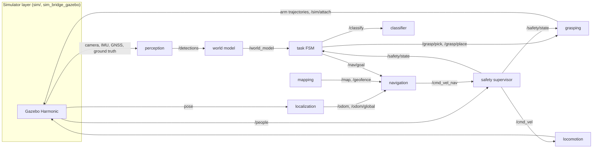

# Beach Cleanup Robot Dog

**A simulated Unitree Go2 quadruped with an arm that is meant to search a beach, pick up litter, sort it by material and empty it into the right bin, with no human in the loop. Every part runs in ROS 2 and Gazebo Harmonic on a laptop CPU.**

> 🚧 **Work in progress (as of 2026-11-13).** The whole loop runs on its own, unattended. Parts A and B are done on ground truth: the best row (`b4_robot_lab_flip`) collected 75 of 110 items, all in the correct bin, with no falls and no safety violations. Part C has started replacing ground truth with real components. The realistic trash visuals are done. Localization (EKF) runs the full loop but doesn't have a clean benchmark row yet, because the arm safety rule still trips at the bins. Grasps still use a simulated attach. See [Progress](#progress).

<p align="center">
  
  &nbsp;
  
  <br>
  <sub>Views from the robot's head camera in Gazebo: a generated beach scene (left) and the custom wide gripper above a cigarette pack (right).</sub>
</p>

<!-- TODO (packaging phase): 60–90 s hero video of a full cleanup run plus 2–3 honest failure clips -->

## The goal

The robot carries a two-compartment basket on its back and runs this loop:

1. **Search.** Walk a lawnmower pattern inside the beach's geofence and look for litter among shells, rocks, seaweed and driftwood.
2. **Pick.** Walk up to an item, stand still and grasp it from above.
3. **Classify.** Hold the item in front of the head camera and decide what material it is: PET, metal, glass or residual.
4. **Store.** Drop it into the matching compartment, **recyclable** or **residual**.
5. **Unload.** When the basket is full or the area is done, walk to the two bins and empty each compartment into its bin.

A rule-based safety supervisor runs throughout. It slows the robot when a person comes within 3 m and stops it early enough that it is at rest before the person is within 1.5 m (the stop distance grows with the robot's speed, as in speed and separation monitoring), keeps it inside the geofence, and freezes the arm unless nobody is nearby.

## Why this project

In Hong Kong I took part in a lot of beach clean-ups. Most of the litter we picked up wasn't left by people on the beach: it washed in from the sea. Hong Kong's own Marine Refuse Study links the refuse on its shores to the seasonal winds and the Pearl River outflow ([LegCo reply, 2016](https://www.info.gov.hk/gia/general/201612/14/P2016121400394p.htm)), and a survey of one west-coast beach found that local sources made up only a small share of the stranded debris ([EdUHK](https://repository.eduhk.hk/en/publications/the-origin-of-stranded-shoreline-macroplastic-debris-in-hong-kong/)). And none of what we collected was recycled: bottles and cans went into general waste with everything else. Picking litter up by hand only to throw it all away seemed like a waste, and not how it should be done today.

So this robot does both jobs: it collects the litter and sorts it on the spot. That is also why the benchmark weights its mistakes: a residual item in the recycling bin spoils the recycling, so it counts double.

## Progress

| Phase | What | Status |
|---|---|---|
| **A0** Setup | Go2 walks on `/cmd_vel` in Gazebo; WidowX 250 arm and two-compartment basket mounted | ✅ done |
| **A1** Beach world | Seeded scenes: dunes, dry and wet sand, trash, distractors, bins, a walking person; sensors bridged to ROS 2 | ✅ done |
| **A2** Walking skeleton | Every component as a ground-truth baseline, a safety supervisor and a task state machine, running end to end unattended | ✅ done |
| **A3** Benchmark | `make bench` over 10 seeded scenes; baseline row | ✅ done |
| **B1** Bin rim height | Release items at each bin's real rim height | ✅ done (row `b1_rim`) |
| **B2** Both bins from one spot | One sideways step between the bins instead of a walk | ✅ done (row `b2_bins`) |
| **B3** Navigation stalls | Get to a spot with room to turn before each Nav2 goal | ✅ done (row `b3_nav`) |
| **B4** Walking controller | A controller that falls less, picked by a fall test | ✅ done (row `b4_robot_lab_flip`) |
| **C1** Localization | EKF over noisy GNSS, leg odometry and IMU | 🟡 built and running the full loop; fixing arm-rule violations at the bins before a clean row |
| **C2** Trash visuals | Textured, realistic trash meshes | ✅ done (1.45 % frame-rate cost, no row) |
| **C3** Perception | Text-prompted detector (YOLOE) + depth | 🟡 built, currently fails its detection and frame-rate checks |
| **C4** Classifier | Zero-shot material classifier, compared with an own colour-based one | 🟡 built, narrowly fails its contamination check |
| **C5** Grasping | Look → plan → move → verify, picks by contact physics | ⬜ planned |
| **D0** Isaac port | Same pipeline in NVIDIA Isaac Sim, changes only in the simulator layer | ⬜ optional |
| **D1** Gazebo vs Isaac | Same benchmark in both simulators | ⬜ optional |

**Part A: the pipeline and the benchmark.** The robot, the beach and every pipeline component are built, first as *baselines* that read the simulator's ground truth, so the whole loop could run end to end before any part was made hard. The first complete unattended run collected and sorted all 6 items of a small dev scene. `make bench` then runs 10 seeded scenes overnight; the baseline row has zero safety violations and every collected item in the right bin, but most runs end in a fall or a navigation stall.

**Part B: make the robot better, still on ground truth.** Each upgrade fixes one failure seen in the benchmark and adds one row, judged against the row before. B1 fixed where items are released over a bin, B2 removed the risky walk between the bins, and B3 removed the navigation stalls: from 17 to 39 collected items, three scenes finished completely. Falls of the walking controller then ended most runs, so B4 replaced it with a learned policy (`robot_lab`), calibrated for the task's small moves: no falls in the final row, 75 collected items and seven scenes finished. Three of the ten runs now end stuck beside a bin, and the cause is still open.

**Part C: replace ground truth with real components.** One component at a time: localization, then perception, classification and finally physics-based grasping. Each row is expected to be equal or worse than the ground-truth rows and shows what making that component real costs. C2 is done. C1, C3 and C4 are built on branches, and none has passed its checks yet. The detector finds under 3 % of nearby trash, and the material classifier lets one item too many into the recyclable bin.

C1 (localization) gets furthest. Its first row collected 87 of 110 items, more than the ground-truth row, with no falls and a mean position error of 0.16 m, but it broke the arm safety rule 5 times. The rule: no arm joint may move more than 0.03 rad within half a second while a person is near. Each re-run stops at its first violation, and each stop has exposed one more cause:

1. The supervisor read the robot's speed from the EKF map pose, which jumps with each GNSS fix. It now uses leg odometry.
2. An arm move stopped for safety coasts on, about 0.045 rad for every rad/s of joint speed. Arm joints are now capped at 0.3 rad/s.
3. The learned walking policy creeps towards the bin while the arm works. After a few places in a row, the folded gripper hooked on the rim and the bin pushed the arm. The robot now re-approaches the bin before each place, and it starts a place only if it isn't too close.
4. Navigation accepts any heading at the bins, so the robot often placed from up to 0.6 m to the side of the bin. From there the arm can catch the corner of the bin's wall. The final approach now ends straight in front of the bin and facing it. A geometry test checks the arm's whole path against every bin wall for that window, and a dev run of the fix is in progress.

The last re-run had three clean scenes before it stopped on the fourth.

**Part D: Isaac Sim (optional).** A port to Isaac Sim that touches only the simulator layer, and a Gazebo-vs-Isaac comparison on the same benchmark. The port can run alongside Part C; the comparison waits for the final pipeline.

Details for every phase (component table, integration runs, what each row showed, the controller tests): **[docs/progress.md](docs/progress.md)**.

## Results

<!-- Filled only from results/results.md, never by hand. -->

10 seeded scenes, one run each, every component reading ground truth, grasps by simulated attach. Full rows, column definitions and per-seed numbers: [`results/results.md`](results/results.md).

| Configuration | Items collected | Sorting accuracy | Contamination | False pickups | Grasp success | Falls / stuck | Safety violations | Min. distance to person | Localization drift |
|---|---|---|---|---|---|---|---|---|---|
| Baseline (ground truth) | 17/110 | 1.00 (17/17) | 0 | 0 | 0.92 (69/75), simulated attach | 7 / 3 of 10 runs | 0 | 0.22 m (robot at rest) | 0.002 m (ground truth) |
| B1: bin rim height from the terrain | 12/110 | 1.00 (12/12) | 0 | 0 | 1.00 (50/50), simulated attach | 10 / 0 of 10 runs | 0 | 0.09 m (robot at rest) | 0.003 m (ground truth) |
| B2: sideways step between the bins | 39/110 | 1.00 (39/39) | 0 | 0 | 0.93 (85/91), simulated attach | 5 / 3 of 10 runs | 1 | 0.04 m (robot at rest) | 0.002 m (ground truth) |
| B3: room to turn before navigating | 39/110 | 1.00 (39/39) | 0 | 0 | 0.93 (81/87), simulated attach | 7 / 0 of 10 runs | 0 | 0.04 m (robot at rest) | 0.003 m (ground truth) |
| B4: learned walking policy (`robot_lab`) | 75/110 | 1.00 (75/75) | 0 | 0 | 0.87 (104/120), simulated attach | 0 / 3 of 10 runs | 0 | 0.02 m (robot at rest) | 0.003 m (ground truth) |

Every item that reached a bin was in the right one. B1 alone looks worse because all 10 of its runs ended in a fall, most of them before any placement. B2's safety violation: the robot kept creeping at 5–6 cm/s for about a second after the supervisor had stopped it. A first B4 row (`b4_robot_lab`, 79/110, in the full results) also had one: the arm kept moving briefly after a safety stop. That was fixed and the row rerun, which gave the B4 row above. What each row changed and why: [docs/progress.md](docs/progress.md#part-b-real-upgrades).

## Design choices

- **Safety is its own layer.** Navigation publishes `/cmd_vel_nav`. Only the supervisor publishes `/cmd_vel`, and it has no shortcut, not even for teleop or debugging. The arm does not go through the supervisor, so the grasping node holds the arm still unless `/safety/state == ok`. Any motion planner added later may only plan, and its trajectories still run through that gate.
- **The interfaces are frozen and the simulator is a component.** Components talk only through a fixed set of ROS 2 topics, services and actions. All Gazebo-specific code lives in `sim/` and `sim_bridge_gazebo`, so porting to Isaac Sim means writing one new bridge package.
- **Mistakes are weighted by their consequence.** The classifier says *what* an item is, and `config/sorting_rules.yaml` says *where* it goes. A residual item in the recycling bin is worse than the reverse, so an item classified with low confidence goes to residual.
- **The map gets the robot near, the camera finishes the job.** Navigation works in the map frame to about half a metre. Grasping and placing work relative to the camera, to the centimetre.
- **No SLAM.** An open beach has too few features for it. Localization will fuse plain GPS (2–3 m noise), leg odometry and IMU.
- **Thresholds live in config.** Safety distances, the geofence, sorting rules and grasp settings are all in `config/`, not in code.

The main trade-offs, with the evidence and the alternatives that were rejected: [docs/design-decisions.md](docs/design-decisions.md).

## Architecture



Each box is its own ROS 2 package in [packages/](packages/). A launch argument chooses between implementations, for example `perception:=ground_truth|yolo` once the upgrade exists.

## Limitations

What this project does not show:

- **Simulation only.** It has not been run on real hardware.
- **Sand is approximated.** It is a heightmap with dry and wet friction zones, not deformable granular sand.
- **Trash is rigid,** and the items are sized to fit the gripper.
- **Grasps "attach on contact"** in the current pipeline. A physics-grasp study exists, but the pipeline doesn't use it yet. Results will be labelled "simulated attach".
- **Material classification** will only be shown on *simulated* textures. Real recycling plants use near-infrared sensors.
- **The custom gripper and basket** are larger than off-the-shelf parts for a robot of this size, and the arm carries more than its rated payload.
- **The walking person is scripted** and has no collision. Safety uses the person's ground-truth position.
- **The walking policy wasn't trained with the arm's weight or very slow commands.** Below about 0.15–0.2 m/s it can stand still, so small moves go through calibrated speed maps. In the latest row, 3 of 10 runs ended stuck about 0.6 m from a bin, cause not known yet. A fall still ends a run.

Full list with reasons: [docs/limitations.md](docs/limitations.md).

## Running it

Requires Ubuntu 24.04, ROS 2 Jazzy and Gazebo Harmonic. No GPU is needed. Exact versions are in [VERSIONS.md](VERSIONS.md).

```bash
# clone into a colcon workspace
mkdir -p ~/ros2_ws/src && cd ~/ros2_ws/src
git clone <this repo> beach_cleaning_robot
beach_cleaning_robot/patches/setup_deps.sh       # pinned third-party repos + patches
cd ~/ros2_ws && colcon build && source install/setup.bash

cd src/beach_cleaning_robot
make generate                  # bench/scenes.yaml for seeds 0-9 (deterministic)
make test                      # unit + node tests, no simulator needed
make scene SEED=3 RVIZ=true    # scene 3 with the robot and sensors, camera in RViz
make run SEED=3                # scene 3 + the full pipeline (A2 skeleton); HEADLESS=true for server only
make bench ROW=my_row          # all 10 benchmark scenes headless, one results row (10–16 h on a laptop)
```

The task writes one event log per run to `results/runs/<RUN_ID>.jsonl`; `make bench` turns the runs into a row in `results/results.md`.

The default walking controller is the `robot_lab` policy; `make run SEED=3 LOCO=legubiao` uses the basic model-based controller instead, and `LOCO=legubiao_rl` the HIMLoco policy. Both policies need CPU libtorch 2.5.0 in `~/libtorch` (download link and checksum in [VERSIONS.md](VERSIONS.md)); build the controller with `Torch_DIR=~/libtorch colcon build --packages-select rl_quadruped_controller`.

## Repository layout

```
packages/   ROS 2 packages: beach_interfaces, beach_description, sim_bridge_gazebo, locomotion,
            localization, mapping, perception, world_model, navigation, grasping, safety, task, bringup
sim/        common/ (scene generator, terrain, procedural meshes), gazebo/ (world builder, test tools)
config/     safety, geofence, sorting rules, grasping, task, ... (all thresholds)
bench/      seeded benchmark scenes
results/    run logs, archived evaluation data (A1 checks, physics-grasp study)
docs/       progress details, limitations, design decisions
patches/    patches for the pinned third-party repos
```

## Related work

- **BinWalker** (IIT, 2026): a quadruped with an arm and a litter bin; it is teleoperated and collects only bottles. [arXiv 2603.10529](https://arxiv.org/abs/2603.10529)
- **VERO** (IIT, Journal of Field Robotics 2024): a quadruped with vacuum nozzles on its feet that collects cigarette butts.
- **Visual Whole-Body Control** (UCSD, CoRL 2024): a legged manipulator that learns to pick objects up from the ground. [Paper](https://proceedings.mlr.press/v270/liu25b.html)
- **RaiBo** (KAIST, Science Robotics 2023): learned quadruped locomotion on real sand.

This project's aim differs: the whole collect-and-sort loop runs autonomously and is measured on a fixed benchmark, in simulation only.

## Stack

Ubuntu 24.04 · ROS 2 Jazzy · Gazebo Harmonic · Nav2 · ros2_control · Pinocchio · Python · (optional: NVIDIA Isaac Sim / Isaac Lab)
