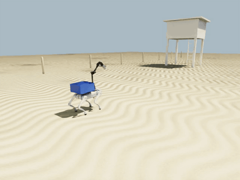
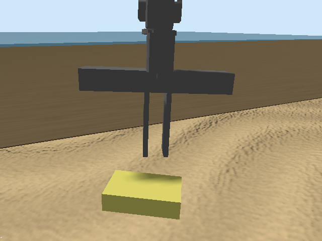
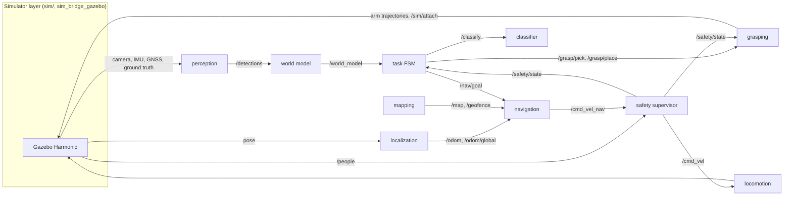

# Beach Cleanup Robot Dog

**A simulated Unitree Go2 quadruped with an arm that is meant to search a beach, pick up litter, sort it by material and empty it into the right bin, with no human in the loop. Every part runs in ROS 2 and Gazebo Harmonic on a laptop CPU.**

> 🚧 **Work in progress (as of 2026-11-17).** The whole loop runs on its own, unattended. Parts A and B1–B5 are done on ground truth: the best row so far (`b5_single`) collected 89 of 110 items, all in the correct bin, with no falls and no safety violations. B5 added a collision check to every arm move, because the arm safety rule kept tripping at the bins. Next is B6, a comparison of arm planners (MoveIt 2 against our own); Part C, which has started replacing ground truth with real components, resumes after it. The realistic trash visuals are done. Grasps still use a simulated attach. See [Progress](#progress).

<p align="center">
  <a href="results/d0/videos/d0_walk_flat.mp4"></a>
  &nbsp;
  
  <br>
  <sub>Left: the robot walking on a generated beach in NVIDIA Isaac Sim 6.2, with the same walking policy as in Gazebo (0.2 m/s forward, then a turn at 0.3 rad/s; click for the video). Right: the custom wide gripper above a cigarette pack, seen from the robot's head camera in Gazebo.</sub>
</p>

<!-- TODO (packaging phase): 60–90 s hero video of a full cleanup run plus 2–3 honest failure clips -->

## The goal

The robot carries a two-compartment basket on its back and runs this loop:

1. **Search.** Walk a lawnmower pattern inside the beach's geofence. A quick look from a distance flags anything that might be litter among the shells, rocks, seaweed and driftwood; at this range it only has to say "worth a closer look".
2. **Inspect.** Walk up to each flagged object and look again from close by. This look decides whether it is litter and gives its exact position and orientation. Anything that isn't litter is left alone and never visited again.
3. **Pick.** Stand still and grasp the item from above.
4. **Classify.** Hold the item in front of the head camera and decide what material it is: PET, metal, glass or residual.
5. **Store.** Put it in the middle of the matching compartment, **recyclable** or **residual**, one item per compartment, and only if it could still be lifted out again wherever it lands. If that compartment is already taken, put the item back down, empty the basket and come back for it.
6. **Unload.** At the two bins, stand in one spot, lift each item back out and release it over its bin, with one sideways step between the two bins.

Every arm move is planned and checked, along its whole path, against the robot's body, the basket, the items in it and the bin before it runs. A move that would come within 5 mm of any of them is replaced by another option or not made at all.

Today every input still comes from the simulator's ground truth, and items are held by a simulated attach. The steps above are the design that Part C makes real one piece at a time; the search-and-inspect split is planned for the far and close detection steps (C3, C4), see [Progress](#progress).

A rule-based safety supervisor runs throughout. It slows the robot when a person comes within 3 m and stops it early enough that it is at rest before the person is within 1.5 m (the stop distance grows with the robot's speed, as in speed and separation monitoring), keeps it inside the geofence, and freezes the arm unless nobody is nearby.

## Why this project

In Hong Kong I took part in a lot of beach clean-ups.  And none of what we collected was recycled: bottles and cans went into general waste with everything else. Picking litter up by hand only to throw it all away seemed like a waste, and not how it should be done today.

So this robot does both jobs: it collects the litter and sorts it on the spot. That is also why the benchmark weights its mistakes: a residual item in the recycling bin spoils the recycling, so it counts double.

## Progress

| Phase | What | Status |
|---|---|---|
| **A0** Setup | Go2 walks on `/cmd_vel` in Gazebo; WidowX 250 arm and two-compartment basket mounted | ✅ done |
| **A1** Beach world | Seeded scenes: dunes, dry and wet sand, trash, distractors, bins, a walking person; sensors bridged to ROS 2 | ✅ done |
| **A1 add-on** Trash visuals | Textured, realistic trash meshes (what a camera sees; sizes and collisions unchanged) | ✅ done (1.45 % frame-rate cost, no row) |
| **A2** Walking skeleton | Every component as a ground-truth baseline, a safety supervisor and a task state machine, running end to end unattended | ✅ done |
| **A3** Benchmark | `make bench` over 10 seeded scenes; baseline row | ✅ done |
| **B1** Bin rim height | Release items at each bin's real rim height | ✅ done (row `b1_rim`) |
| **B2** Both bins from one spot | One sideways step between the bins instead of a walk | ✅ done (row `b2_bins`) |
| **B3** Navigation stalls | Get to a spot with room to turn before each Nav2 goal | ✅ done (row `b3_nav`) |
| **B4** Walking controller | A controller that falls less, picked by a fall test | ✅ done (row `b4_robot_lab_flip`) |
| **B5** Collision-checked arm moves | Every arm move checked against the robot, the basket, the items in it and the bin; one item per compartment, stored only where it can be lifted out again; plus the arm and bin fixes from C1 (slower arm joints, wrist turn, bin approach) and its stricter geofence margins | ✅ done (row `b5_single`) |
| **B6** Arm planner comparison | MoveIt 2 against our own collision-checked planner, same ground-truth inputs | ⬜ next |
| **C1** Localization | EKF over noisy GNSS, leg odometry and IMU | 🟡 built and running the full loop; paused, resumes on top of B5 |
| **C3** Far detection | Find trash while searching (1–4 m): text-prompted detector (YOLOE) + depth | 🟡 built, currently fails its detection and frame-rate checks |
| **C4** Close detection | Exact position and yaw of the chosen item before the grasp (0.3–1 m), from depth | ⬜ planned |
| **C5** Classifier | Material of the held item: zero-shot classifier, compared with an own colour-based one | 🟡 built, narrowly fails its contamination check |
| **C6** Physics grasping | Items held by contact physics instead of attached; several grasp options with retry, and a check that the pick worked | ⬜ planned |
| **D0** Isaac preparation | The scenes in USD, the robot walking with the same policy as in Gazebo, and the arm picking in attach mode, all in Isaac Sim 6.2 | ✅ done ($1.07 of GPU) |
| **D1** Isaac port | Same pipeline in NVIDIA Isaac Sim, changes only in the simulator layer | ⬜ optional |
| **D2** Gazebo vs Isaac | Same benchmark in both simulators | ⬜ optional |

**Part A: the pipeline and the benchmark.** The robot, the beach and every pipeline component are built, first as *baselines* that read the simulator's ground truth, so the whole loop could run end to end before any part was made hard. The first complete unattended run collected and sorted all 6 items of a small dev scene. `make bench` then runs 10 seeded scenes overnight; the baseline row has zero safety violations and every collected item in the right bin, but most runs end in a fall or a navigation stall.

**Part B: make the robot better, still on ground truth.** Each upgrade fixes one failure seen in the benchmark and adds one row, judged against the row before. B1 fixed where items are released over a bin, B2 removed the risky walk between the bins, and B3 removed the navigation stalls: from 17 to 39 collected items, three scenes finished completely. Falls of the walking controller then ended most runs, so B4 replaced it with a learned policy (`robot_lab`), calibrated for the task's small moves: no falls in the final row, 75 collected items and seven scenes finished. Three of the ten runs still ended stuck beside a bin.

B5 was added after the localization work (below): every arm-rule violation found there was a contact the arm planner never checked. The planner now checks each arm move, along its whole path, against the robot's body, the basket, the items already in it and the bin, with 5 mm of clearance. A move that fails takes another option or is refused. Packing several items per compartment didn't survive the check: items land 5–15 mm off their planned spot in the simulator, and a packed compartment then often held an item that no checked move could lift out again. The robot now stores one item in the middle of each compartment, and only if that item could still be lifted out wherever it lands within the measured drop and walking error. That costs time: it walks to the bins after every two items, and each store takes 12–33 s of planning and checking. The row also carries the arm and bin fixes from the localization work (below): arm joints capped at 0.3 rad/s, the wrist kept near its last turn, a fresh approach before each place, and places only from straight in front of the bin. It also keeps that work's stricter safety margins, which stay on with ground truth: the geofence stop starts 0.5 m from the fence (was 0.3 m), and search lanes stay 0.7 m inside it. So it doesn't isolate the collision check: compared with the B4 row, it measures the check, the one-item basket and those fixes together.

The B5 row collected 89 of 110 items (B4: 75), all in the right bin, with no falls, no safety violations and no run stuck at a bin. Five scenes finished; the other five hit the 200-minute wall-clock cap, because the robot now walks to the bins every one or two items. The check still refuses some items: 7 flat cigarette packs and 3 glass bottles stayed on the beach because no checked move could store them. Whether the check also prevents the arm violations seen in the localization work (below) is not shown yet: those all happened with the EKF on, and the ground-truth rows had none. That is tested when C1 resumes on top of B5.

**Part C: replace ground truth with real components.** One component at a time: localization, then the robot's three looks at an item (far detection while searching, close detection before the grasp, classification of the held item), and finally physics: items held by contact forces instead of being attached to the gripper. The comparison of arm planners (MoveIt 2 against our own) changes no input, so it is a Part B step (B6). Each row is expected to be equal or worse than the ground-truth rows and shows what making that component real costs. Each component is first checked offline, on scenes and images of its own; it gets a benchmark row only if it passes, and a failed check is reported with its numbers and causes instead. C1, C3 and C5 are built on branches, and none has passed its checks yet. The far detector finds under 3 % of nearby trash, and the material classifier lets one item too many into the recyclable bin. Steps that aren't real yet keep their ground-truth version, so C4 and C6 can go ahead without C3 and C5.

C1 (localization) gets furthest. Its first row collected 87 of 110 items, more than the ground-truth row, with no falls and a mean position error of 0.16 m, but it broke the arm safety rule 5 times. The rule: no arm joint may move more than 0.03 rad within half a second while a person is near. Each re-run stops at its first violation, and each stop has exposed one more cause:

1. The supervisor read the robot's speed from the EKF map pose, which jumps with each GNSS fix. It now uses leg odometry.
2. An arm move stopped for safety coasts on, about 0.045 rad for every rad/s of joint speed. Arm joints are now capped at 0.3 rad/s.
3. The learned walking policy creeps towards the bin while the arm works. After a few places in a row, the folded gripper hooked on the rim and the bin pushed the arm. The robot now re-approaches the bin before each place, and it starts a place only if it isn't too close.
4. Navigation accepts any heading at the bins, so the robot often placed from up to 0.6 m to the side of the bin. From there the arm can catch the corner of the bin's wall. The final approach now ends straight in front of the bin and facing it. A geometry test checks the arm's whole path against every bin wall for that window.
5. While lowering a bottle into the basket, the wrist turned half a revolution and swung the bottle through the basket walls. Store and unload moves now keep the wrist turn nearest to where it was.

Every one of these causes was a contact that no part of the arm planner checked, so C1 was paused while B5 (above) added that check. C1 resumes on top of B5 after B6.

**Part D: Isaac Sim (optional).** D0 prepared everything the port needs and ran it in NVIDIA Isaac Sim 6.2 on two short rented-GPU sessions ($1.07 in total): the 11 benchmark scenes open and render from the same views as Gazebo; the robot walks with the same `robot_lab` policy file as in Gazebo (17–26 % slower forward, turning within 8 %, no falls on flat ground or dunes); and the arm picks a bottle, a can and a cup from 3 spots each and stores all 9 in the right basket compartment. Next: the port of the whole pipeline (D1), which only touches the simulator layer; the Gazebo-vs-Isaac comparison waits for the final pipeline.

Details for every phase (component table, integration runs, what each row showed, the controller tests): **[docs/progress.md](docs/progress.md)**.

## Results

<!-- Filled only from results/results.md, never by hand. -->

10 seeded scenes, one run each, every component reading ground truth, grasps by simulated attach. Full rows, column definitions and per-seed numbers: [`results/results.md`](results/results.md).

| Configuration | Items collected | Sorting accuracy | Contamination | False pickups | Grasp success | Falls / stuck | Safety violations | Min. distance to person | Localization drift |
|---|---|---|---|---|---|---|---|---|---|
| Baseline (ground truth) | 17/110 | 1.00 (17/17) | 0 | 0 | 0.92 (69/75), simulated attach | 7 / 3 of 10 runs | 0 | 0.22 m (robot at rest) | 0.002 m (ground truth) |
| B1: bin rim height from the terrain | 12/110 | 1.00 (12/12) | 0 | 0 | 1.00 (50/50), simulated attach | 10 / 0 of 10 runs | 0 | 0.09 m (robot at rest) | 0.003 m (ground truth) |
| B2: sideways step between the bins | 39/110 | 1.00 (39/39) | 0 | 0 | 0.93 (85/91), simulated attach | 5 / 3 of 10 runs | 1 | 0.04 m (robot at rest) | 0.002 m (ground truth) |
| B3: room to turn before navigating | 39/110 | 1.00 (39/39) | 0 | 0 | 0.93 (81/87), simulated attach | 7 / 0 of 10 runs | 0 | 0.04 m (robot at rest) | 0.003 m (ground truth) |
| B4: learned walking policy (`robot_lab`) | 75/110 | 1.00 (75/75) | 0 | 0 | 0.87 (104/120), simulated attach | 0 / 3 of 10 runs | 0 | 0.02 m (robot at rest) | 0.003 m (ground truth) |
| B5: collision-checked arm moves, one item per compartment | 89/110 | 1.00 (89/89) | 0 | 0 | 0.86 (143/166), simulated attach | 0 / 0 of 10 runs | 0 | 0.03 m (robot at rest) | 0.002 m (ground truth) |

Every item that reached a bin was in the right one. B1 alone looks worse because all 10 of its runs ended in a fall, most of them before any placement. B2's safety violation: the robot kept creeping at 5–6 cm/s for about a second after the supervisor had stopped it. A first B4 row (`b4_robot_lab`, 79/110, in the full results) also had one: the arm kept moving briefly after a safety stop. That was fixed and the row rerun, which gave the B4 row above. B5 ended no run stuck or fallen, but 5 of its 10 runs hit the 200-minute wall-clock cap: one item per compartment means a trip to the bins every one or two items, so it collects fewer items per minute than B4 (0.17 against 0.24) while collecting more in total. What each row changed and why: [docs/progress.md](docs/progress.md#part-b-real-upgrades).

**One change per row, where possible.** Each row is meant to isolate one upgrade. In practice a benchmark row takes 20–30 hours (10 scenes on a laptop CPU at about a quarter of real time), and one run often uncovers several connected problems: fixing one exposes the next. So some rows carry more than one change, B5 most of all: the collision check, the one-item basket it forced, the arm and bin fixes from the localization work, and that work's stricter geofence margins, which came along only because B5 was built on top of it. Such a row measures the bundle, not each part. To keep the parts apart anyway, every fix is a config switch that can be turned off, each was first checked in an isolated test or a single development run, and [docs/progress.md](docs/progress.md#b5-collision-checked-arm-moves-row-b5_single) lists what each row adds against the row before.

## Design choices

- **Safety is its own layer.** Navigation publishes `/cmd_vel_nav`. Only the supervisor publishes `/cmd_vel`, and it has no shortcut, not even for teleop or debugging. The arm does not go through the supervisor, so the grasping node holds the arm still unless `/safety/state == ok`. Any motion planner added later may only plan, and its trajectories still run through that gate.
- **The interfaces are frozen and the simulator is a component.** Components talk only through a fixed set of ROS 2 topics, services and actions. All Gazebo-specific code lives in `sim/` and `sim_bridge_gazebo`, so porting to Isaac Sim means writing one new bridge package.
- **Mistakes are weighted by their consequence.** The classifier says *what* an item is, and `config/sorting_rules.yaml` says *where* it goes. A residual item in the recycling bin is worse than the reverse, so an item classified with low confidence goes to residual.
- **The map gets the robot near, the camera finishes the job.** Navigation works in the map frame to about half a metre. Grasping and placing work relative to the camera, to the centimetre.
- **No SLAM.** An open beach has too few features for it. Localization will fuse plain GPS (2–3 m noise), leg odometry and IMU.
- **Thresholds live in config.** Safety distances, the geofence, sorting rules and grasp settings are all in `config/`, not in code.

The main trade-offs, with the evidence and the alternatives that were rejected: [docs/design-decisions.md](docs/design-decisions.md).

## Architecture



Each box is its own ROS 2 package in [packages/](packages/). A launch argument chooses between implementations, for example `perception:=ground_truth|yolo` once the upgrade exists.

## Limitations

What this project does not show:

- **Simulation only.** It has not been run on real hardware.
- **Sand is approximated.** It is a heightmap with dry and wet friction zones, not deformable granular sand.
- **Trash is rigid,** and the items are sized to fit the gripper.
- **Grasps "attach on contact"** in the current pipeline. A physics-grasp study exists, but the pipeline doesn't use it yet. Results will be labelled "simulated attach".
- **Material classification** will only be shown on *simulated* textures. Real recycling plants use near-infrared sensors.
- **The custom gripper and basket** are larger than off-the-shelf parts for a robot of this size, and the arm carries more than its rated payload.
- **One item per basket compartment (B5).** Every arm move is collision-checked, and only an item that could still be lifted out is stored. That keeps the arm clear of the basket, but the robot carries at most two items per trip to the bins, and a flat item that can't pass the check is put back on the sand.
- **The walking person is scripted** and has no collision. Safety uses the person's ground-truth position.
- **The walking policy wasn't trained with the arm's weight or very slow commands.** Below about 0.15–0.2 m/s it can stand still, so small moves go through calibrated speed maps. In the B4 row, 3 of 10 runs ended stuck about 0.6 m from a bin; with the bin-approach fixes in the B5 row, none did. A fall still ends a run.

Full list with reasons: [docs/limitations.md](docs/limitations.md).

## Running it

Requires Ubuntu 24.04, ROS 2 Jazzy and Gazebo Harmonic. No GPU is needed. Exact versions are in [VERSIONS.md](VERSIONS.md).

```bash
# clone into a colcon workspace
mkdir -p ~/ros2_ws/src && cd ~/ros2_ws/src
git clone <this repo> beach_cleaning_robot
beach_cleaning_robot/patches/setup_deps.sh       # pinned third-party repos + patches
cd ~/ros2_ws && colcon build && source install/setup.bash

cd src/beach_cleaning_robot
make generate                  # bench/scenes.yaml for seeds 0-9 (deterministic)
make test                      # unit + node tests, no simulator needed
make scene SEED=3 RVIZ=true    # scene 3 with the robot and sensors, camera in RViz
make run SEED=3                # scene 3 + the full pipeline (A2 skeleton); HEADLESS=true for server only
make bench ROW=my_row          # all 10 benchmark scenes headless, one results row (20–30 h on a laptop)
```

The task writes one event log per run to `results/runs/<RUN_ID>.jsonl`; `make bench` turns the runs into a row in `results/results.md`.

The default walking controller is the `robot_lab` policy; `make run SEED=3 LOCO=legubiao` uses the basic model-based controller instead, and `LOCO=legubiao_rl` the HIMLoco policy. Both policies need CPU libtorch 2.5.0 in `~/libtorch` (download link and checksum in [VERSIONS.md](VERSIONS.md)); build the controller with `Torch_DIR=~/libtorch colcon build --packages-select rl_quadruped_controller`.

## Repository layout

```
packages/   ROS 2 packages: beach_interfaces, beach_description, sim_bridge_gazebo, locomotion,
            localization, mapping, perception, world_model, navigation, grasping, safety, task, bringup
sim/        common/ (scene generator, terrain, procedural meshes), gazebo/ (world builder, test tools)
config/     safety, geofence, sorting rules, grasping, task, ... (all thresholds)
bench/      seeded benchmark scenes
results/    run logs, archived evaluation data (A1 checks, physics-grasp study)
docs/       progress details, limitations, design decisions
patches/    patches for the pinned third-party repos
```

## Related work

- **BinWalker** (IIT, 2026): a quadruped with an arm and a litter bin; it is teleoperated and collects only bottles. [arXiv 2603.10529](https://arxiv.org/abs/2603.10529)
- **VERO** (IIT, Journal of Field Robotics 2024): a quadruped with vacuum nozzles on its feet that collects cigarette butts.
- **Visual Whole-Body Control** (UCSD, CoRL 2024): a legged manipulator that learns to pick objects up from the ground. [Paper](https://proceedings.mlr.press/v270/liu25b.html)
- **RaiBo** (KAIST, Science Robotics 2023): learned quadruped locomotion on real sand.

This project's aim differs: the whole collect-and-sort loop runs autonomously and is measured on a fixed benchmark, in simulation only.

## Stack

Ubuntu 24.04 · ROS 2 Jazzy · Gazebo Harmonic · Nav2 · ros2_control · Pinocchio · Python · (optional: NVIDIA Isaac Sim / Isaac Lab)
